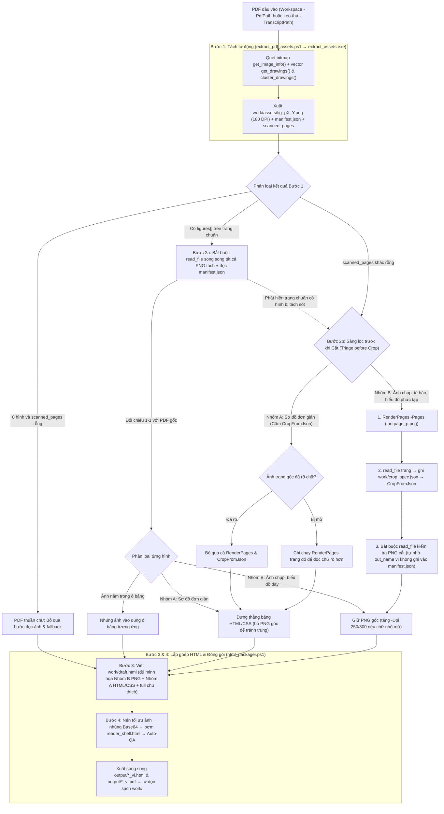

## Cách công cụ xử lý ảnh

Công cụ kết hợp tách ảnh tự động bằng PyMuPDF (`extract_assets.exe`) ở Bước 1 cho cả **ảnh bitmap** lẫn **sơ đồ/biểu đồ vector**, kèm cơ chế **Sàng lọc trước khi Cắt (`Triage before Crop`)** để không lãng phí công đoạn cắt thủ công cho các sơ đồ đơn giản dựng lại được bằng HTML/CSS, đồng thời bắt buộc đối chiếu trực quan song song các tệp PNG đã tách trước khi đóng gói:

## Cách công cụ giảm dung lượng ảnh
Đây là phần thông tin kỹ thuật, phục vụ mục đích bảo trì là chủ yếu, người dùng có thể bỏ qua nếu không quan tâm. 

Ở Bước 4, [`html_packager.ps1`](./tools/html_packager.ps1) gọi `extract_assets.exe` ([`packager.py`](./tools/src/packager.py) & [`image_ops.py`](./tools/src/image_ops.py)) để tối ưu từng ảnh cục bộ ngay trong RAM trước khi mã hóa Base64 nhúng vào HTML:

```mermaid
flowchart TD
    IN["Thẻ img cục bộ trong draft.html (.png / .jpg / .jpeg)"] --> CACHE{"Đã có trong opt_cache (ảnh lặp lại)?"}
    CACHE -->|"Có"| REUSE["Dùng lại chuỗi data URI Base64 đã lưu trong RAM"]
    CACHE -->|"Chưa"| READ["Đọc orig_bytes vào RAM & xác định orig_mime; chuẩn hóa CMYK sang RGB/Gray"]

    subgraph ANALYZE["1. Phân tích lưới mẫu ~60x60 điểm ảnh (_analyze_sample_grid)"]
        READ --> ALPHACHK{"Có điểm nào alpha nhỏ hơn 250?"}
        ALPHACHK -->|"Có"| HA1["has_alpha = True (có nền trong suốt)"]
        ALPHACHK -->|"Không"| HA0["has_alpha = False (ảnh đặc)"]

        HA1 --> GRAYCHK
        HA0 --> GRAYCHK{"Mọi điểm mẫu đều là thang xám (max-min <= 2)?"}
        GRAYCHK -->|"Có"| C8["Đếm sắc độ xám 8-bit (0..255)"]
        GRAYCHK -->|"Không (ảnh có màu)"| C15["Đếm cụm màu 15-bit (r>>3, g>>3, b>>3)"]

        C8 --> RICH{"distinct_colors >= 200?"}
        C15 --> RICH
        RICH -->|"Đúng"| R1["is_rich_photo = True (ảnh chụp / X-quang / ảnh nhiệt)"]
        RICH -->|"Sai"| R0["is_rich_photo = False (sơ đồ / chữ / biểu đồ ít màu)"]
    end

    subgraph RESIZE["2. Kiểm tra giới hạn chiều ngang (MaxImageWidth = 1400 px)"]
        R1 --> WCHK
        R0 --> WCHK{"MaxImageWidth > 0 và width > 1400 px?"}
        WCHK -->|"Có"| DO_RS["Co kích thước giữ tỷ lệ về 1400 px -> work_pix (was_resized = True)"]
        WCHK -->|"Không"| NO_RS["Giữ kích thước gốc -> work_pix (was_resized = False)"]
    end

    subgraph COMPRESS["3. Chọn định dạng nén nhỏ hơn & giữ chất lượng (_optimize_image_bytes)"]
        DO_RS --> J_ELIG
        NO_RS --> J_ELIG{"Không trong suốt (!has_alpha) VÀ (is_rich_photo HOẶC đã resize từ JPEG gốc)?"}

        J_ELIG -->|"Có"| EN_JPG["Bỏ alpha dư (nếu có) & nén work_pix sang JPEG (quality = 95)"]
        EN_JPG --> J_SZ{"was_resized=True: jpg < orig_bytes? | was_resized=False: jpg <= 85% orig_bytes?"}
        J_SZ -->|"Đạt"| OUT_JPG["Trả về JPEG đã tối ưu (image/jpeg)"]
        J_SZ -->|"Không đạt"| P_ELIG

        J_ELIG -->|"Không"| P_ELIG{"was_resized = True VÀ orig_mime là image/png?"}
        P_ELIG -->|"Có"| EN_PNG["Xuất work_pix sang PNG không mất dữ liệu"]
        EN_PNG --> P_SZ{"png < orig_bytes?"}
        P_SZ -->|"Đạt"| OUT_PNG["Trả về PNG đã thu nhỏ (image/png)"]
        P_SZ -->|"Không đạt"| OUT_ORIG

        P_ELIG -->|"Không"| OUT_ORIG["Giữ nguyên 100% orig_bytes & orig_mime ban đầu"]
    end

    OUT_JPG --> B64["Mã hóa Base64 trong RAM -> lưu opt_cache -> nhúng vào HTML"]
    OUT_PNG --> B64
    OUT_ORIG --> B64
    REUSE --> DONE["Nhúng hoàn tất (không tạo ảnh tạm trên đĩa)"]
    B64 --> DONE
```

**Tóm tắt ý nghĩa 3 chốt bảo vệ:**
1. **Không làm nhòe sơ đồ nét mảnh:** Chỉ ảnh đặc (`!has_alpha`) và nhiều màu/sắc độ (`>= 200`) mới chuyển sang JPEG `95`; sơ đồ ít màu hoặc ảnh trong suốt luôn giữ PNG (chỉ thu nhỏ khi quá `1400 px`).
2. **Không bao giờ làm phình file:** Nếu bản nén lại không nhẹ hơn gốc (hoặc ảnh chụp không resize mà tiết kiệm dưới `15%`), công cụ tự động quay về dùng ảnh gốc.
3. **Không xử lý trùng lặp & không ghi rác ra đĩa:** Toàn bộ quá trình chạy trên RAM và dùng `opt_cache` nếu cùng một ảnh xuất hiện nhiều lần trong tài liệu.